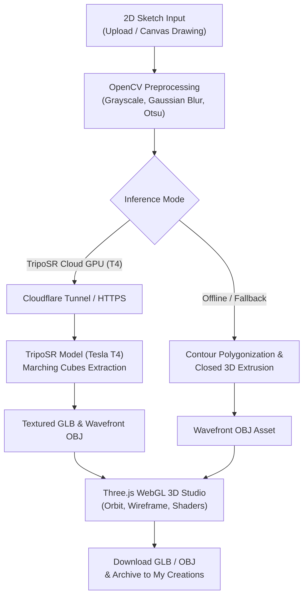

# SKETCH2SHAPE AI

> **From 2D Sketch to 3D Reality**  
> AI-Powered 2D-to-3D Reconstruction Studio  
> *Developed for TechZephyr 4.0 Hackathon • IIT Bhubaneswar*

---

## 📌 Overview

**SKETCH2SHAPE AI** is a state-of-the-art computer vision and generative AI platform that transforms 2D hand-drawn concepts into intelligent 3D spatial models.

The system features a **hybrid dual-engine architecture**:
1. **Cloud Generative AI Engine (TripoSR on NVIDIA Tesla T4)**: Feed-forward neural network predicting continuous 3D triplane representations and extracting textured GLB/OBJ models in ~1.5 seconds.
2. **Deterministic On-Device Fallback (OpenCV Contour Extrusion)**: Multi-pass classical computer vision pipeline ensuring 100% offline availability on standard consumer laptops.

---

## 🚀 Quick Start

### 1. Installation
Install local dependencies:

```bash
pip install -r requirements.txt
```

### 2. Launch the Streamlit Studio
Run from the workspace root or project directory:

```bash
python -m streamlit run app/app.py
```

Open `http://localhost:8501` in your browser.

---

## ☁️ Google Colab TripoSR Cloud Setup (Tesla T4)

To connect your local Streamlit app to the real TripoSR model running on a free Google Colab **NVIDIA Tesla T4 GPU (14.56 GB VRAM)**:

1. Open [Google Colab](https://colab.research.google.com).
2. Upload the notebook located at [`colab/triposr_colab_server.ipynb`](file:///C:/Users/Soumyajit/Desktop/Sketch2Shape_AI/Sketch2Shape_AI/colab/triposr_colab_server.ipynb).
3. In Colab, click **Runtime > Change runtime type**, select **T4 GPU**, and click **Save**.
4. Select **Runtime > Run all** (or press `Ctrl+F9`).
5. In the output of Step 4, copy the generated public HTTPS URL:
   ```text
   https://xxxx.trycloudflare.com
   ```
6. Paste this URL into the Streamlit sidebar under **"Cloud Backend URL"** and click **"🔌 Test Connection"**.
7. You will see:
   ```text
   🟢 Online: TripoSR (stabilityai/TripoSR)
   GPU: NVIDIA Tesla T4 (XXms)
   ```
8. Click **"🚀 GENERATE 3D MODEL"** to generate real 3D geometry with vertex colors/textures in under 2 seconds!

---

## 🛠️ System Architecture



---

## 🏛️ Event & Team Details

- **Event**: TechZephyr 4.0 Hackathon
- **Institution**: IIT Bhubaneswar
- **Domain**: Computer Vision & Generative AI
- **Technologies**: TripoSR, PyTorch, CUDA, FastAPI, OpenCV, Three.js, WebGL, Streamlit
